<div align="center">

# ViewTouch©

**The Original Graphical Touchscreen Restaurant Point of Sale Interface**

[](https://gitter.im/ViewTouch/viewtouch?utm_source=badge&utm_medium=badge&utm_campaign=pr-badge&utm_content=badge)
[](https://www.gnu.org/licenses/gpl-3.0)
[](https://en.wikipedia.org/wiki/C%2B%2B23)

*ViewTouch is a registered trademark in the USA*

[Website](http://www.viewtouch.com) • [Wiki & Documentation](../../wiki) • [Download Image](http://www.viewtouch.com/nc.html)

</div>

---

## ViewTouch Modern

**ViewTouch is now a ground-up rewrite of ViewTouch in C++23 and Qt 6 (QML).** It keeps ViewTouch's best idea, that every screen is a page of buttons you design yourself, and adds what a restaurant needs today. It runs on Linux PCs, touch screens, Raspberry Pi and Android tablets, entirely on site.

📖 **[User manual (PDF)](https://github.com/ViewTouch/viewtouch/releases/download/modern-manual-0.9/ViewTouch-User-Manual.pdf)** · 🛠️ **[Developer README](modern/README.md)** · 🗺️ **[Plan](modern/docs/PLAN.md)**

<table>
<tr>
<td width="50%">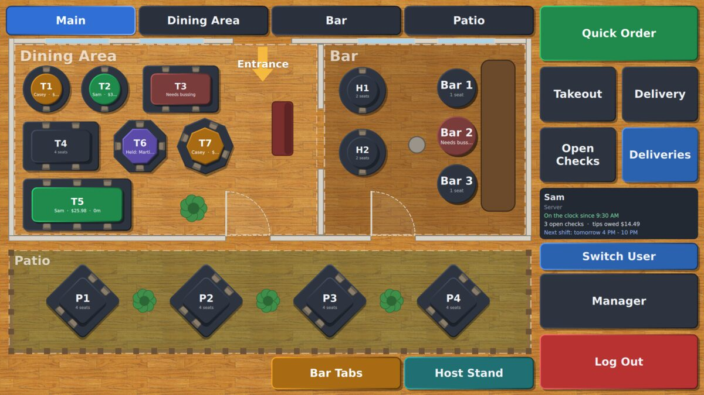<br><sub><b>Floor plans.</b> Main, Dining Area, Bar and Patio, with walls and chairs. Tables show who has them, the total and how long they've been seated.</sub></td>
<td width="50%">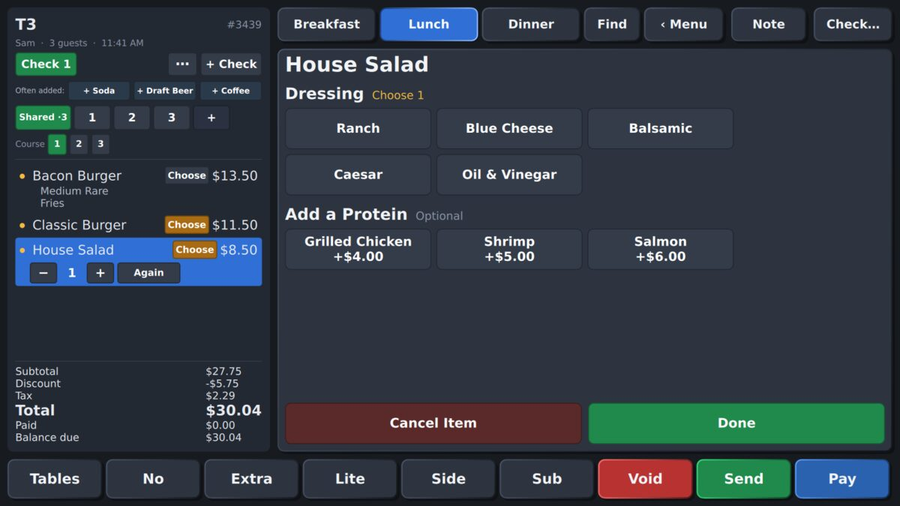<br><sub><b>Taking an order.</b> Items ask for their choices: temperature, sides, dressings.</sub></td>
</tr>
<tr>
<td>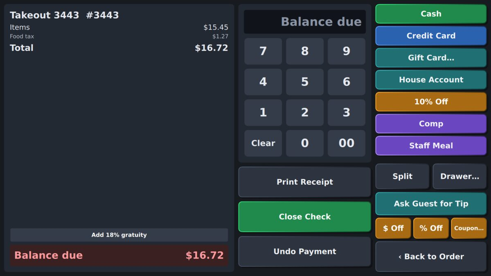<br><sub><b>Paying.</b> Cash, cards, gift cards, house accounts, discounts and splits.</sub></td>
<td>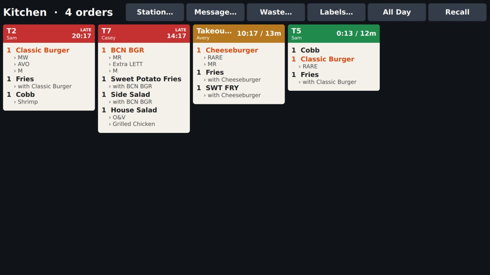<br><sub><b>Kitchen display.</b> Touch to bump. Expo, rush and all-day counts too.</sub></td>
</tr>
<tr>
<td>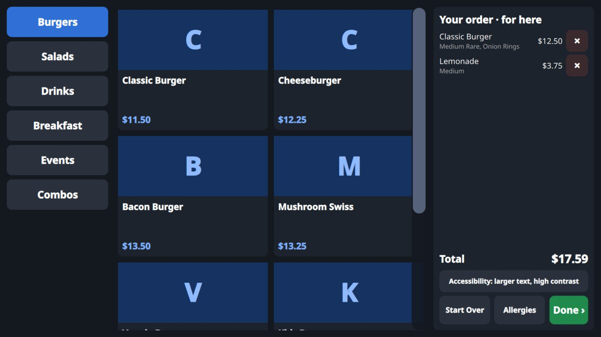<br><sub><b>Self-order kiosk.</b> Guests order on their own and pay at the counter.</sub></td>
<td>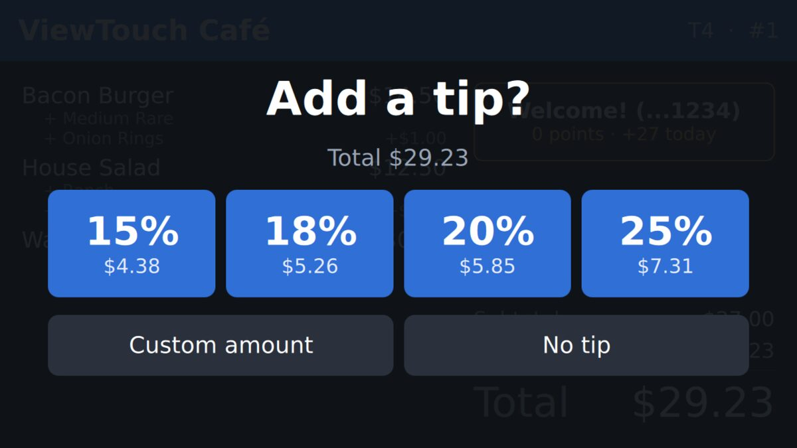<br><sub><b>Customer display.</b> The guest sees the order, picks a tip and earns rewards.</sub></td>
</tr>
<tr>
<td>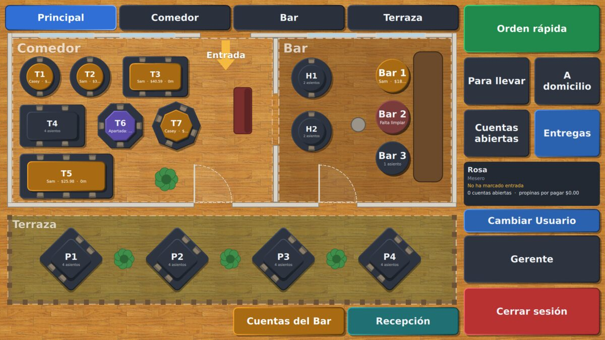<br><sub><b>Five languages.</b> English, Spanish, French, Portuguese and Chinese: each person's screens are in their own.</sub></td>
<td>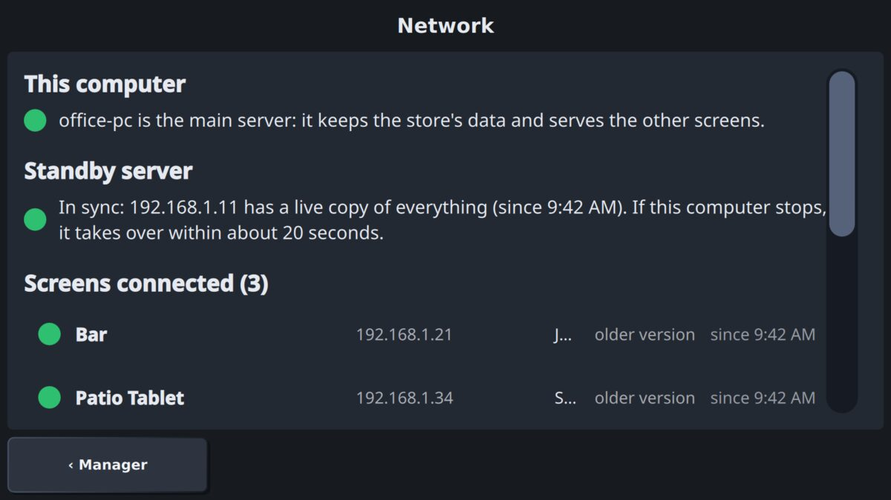<br><sub><b>Keep running.</b> A standby computer takes over if the main one fails.</sub></td>
</tr>
<tr>
<td>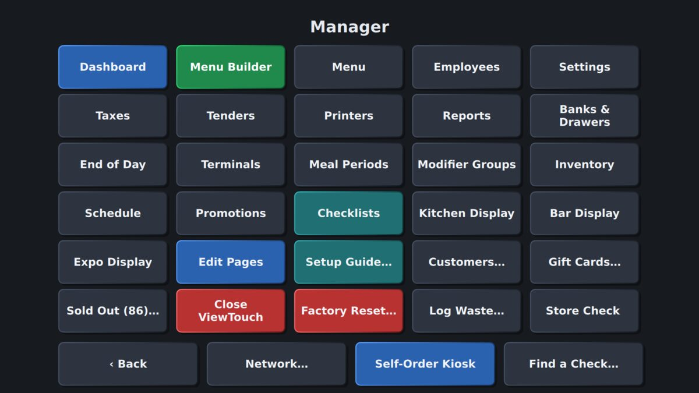<br><sub><b>Manager.</b> Menu, staff, schedule, inventory, promotions and reports.</sub></td>
<td>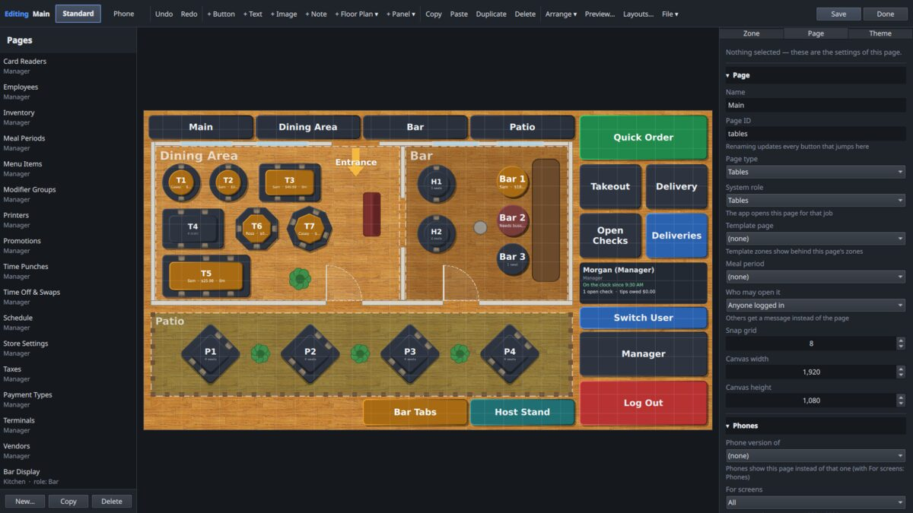<br><sub><b>Design your own screens.</b> Move, resize and restyle any button, with undo.</sub></td>
</tr>
</table>

### What it does

- **Orders:** tables and seats, courses with hold and fire, modifier choices, notes, rush and VIP, transfer, move, merge, split and reopen checks.
- **At the table on a handheld:** seat chips across the check, a buzz and a flash for every item, allergies by seat (only that guest's items are marked, and the kitchen ticket says whose), each server's own usual items, the tables as big tiles that show what hasn't been sent, and taps kept through a Wi-Fi dead spot and sent once it's back.
- **Payments:** cash, Stripe card readers (beside the register, or ViewTouch on the reader as a handheld), a credit card surcharge that debit cards never pay (the reader says which kind of card it is) or a cash discount with both prices shown, gift cards, house accounts, discounts, party gratuity, tips asked on the customer display, server banks or a drawer per screen.
- **Guests:** a customer display, a self-order kiosk, customer records, loyalty points and rewards, promotions such as happy hour, and a waitlist and reservations with "your table is ready" texts.
- **Kitchen:** kitchen, bar and expo touchscreens with ticket times, kitchen names and colors, and printers.
- **Rush Radar:** each kitchen station's next half hour ("Grill backs up to 27 min at 7:42"), from what's on the line, the tables just seated, the waitlist and the store's usual nights, at the pace each station has shown. On the Dashboard and the kitchen screens.
- **Back office:** reports by day or any range against last year (sales, items, labor, tips, kitchen times, food cost, audit), schedule and overtime, tip-outs, inventory with recipes and automatic 86, and CSV/PDF export.
- **Staff:** PIN login and clock in/out, breaks, roles with per-person permissions, manager approval on the spot, practice mode for training, and messages between screens.
- **Many screens, one store:** paired, encrypted connections. Tablets and phones join by scanning the network. A standby server keeps running if the main computer fails.
- **Safe:** every sale is saved at once, with automatic and optionally encrypted backups, a second copy on USB, and a damaged-database check at start.
- **Five languages:** English, Spanish, French, Portuguese and Chinese; each person's screens are in their own.

<table align="center"><tr>
<td align="center">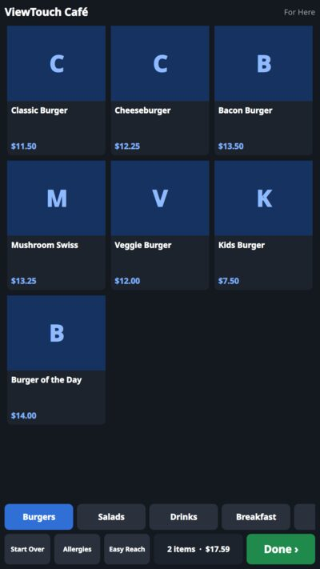<br><sub>The self-order kiosk on a tall<br>21.5" stand, buttons within reach.</sub></td>
<td align="center">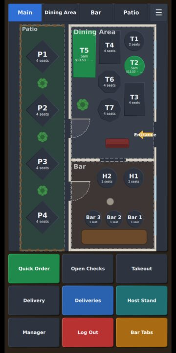<br><sub>Phones get their own<br>pages, with the floor plan.</sub></td>
<td align="center">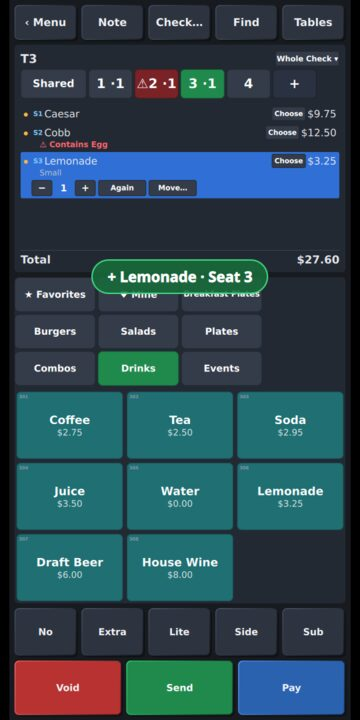<br><sub>At the table: seats, a guest's<br>allergy, "+ Lemonade · Seat 3".</sub></td>
<td align="center">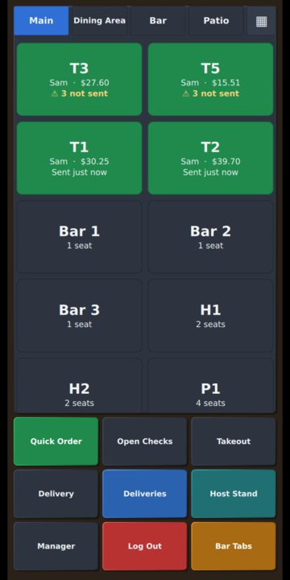<br><sub>Your tables first, with<br>what hasn't been sent.</sub></td>
</tr></table>

### Download and build

ViewTouch Modern needs **Linux with Qt 6.8 or newer**: Fedora 42+, Debian 13 (and Raspberry Pi OS based on it) or Ubuntu 25.04+.

**1. Install what it needs to build**

```sh
# Fedora
sudo dnf install git gcc-c++ cmake ninja-build qt6-qtbase-devel qt6-qtdeclarative-devel

# Debian / Ubuntu / Raspberry Pi OS
sudo apt install git g++ cmake ninja-build qt6-base-dev qt6-declarative-dev qt6-declarative-dev-tools libgl-dev \
    qml6-module-qtquick qml6-module-qtquick-controls qml6-module-qtquick-layouts qml6-module-qtquick-shapes \
    qml6-module-qtquick-dialogs qml6-module-qtquick-window qml6-module-qtqml-workerscript libqt6sql6-sqlite
```

**2. Get the code and build it**

```sh
git clone https://github.com/ViewTouch/viewtouch.git
cd viewtouch
cmake -S modern -B modern/build -G Ninja -DCMAKE_BUILD_TYPE=Release
cmake --build modern/build
ctest --test-dir modern/build -j4      # optional: about 590 tests
```

**3. Run it**

```sh
./modern/build/vtmodern --windowed     # a demo café opens; manager PIN 1234, server PIN 1111
./modern/build/vtmodern --demo-data    # optional, once: fill the demo store with two months of sales
```

**Upgrade Procedure. Be sure to be in the build directory named (viewtouch)**

```sh
git pull origin main
cmake -S modern -B modern/build -G Ninja -DCMAKE_BUILD_TYPE=Release
cmake --build modern/build -j2
```

ViewTouch starts with a demo store (menu, floor plan, staff), so you can try everything right away. Its data lives in `~/.local/share/ViewTouch/ViewTouch/`. Press **F11** to switch between full screen and a window.

| Demo PIN | Who |
|---|---|
| 1234 | Morgan, manager (everything) |
| 1111 | Sam, server |
| 2222 | Casey, cashier |
| 5555 | Rosa, server whose screens are in Spanish |

### Running a real store

Build installable packages (`.rpm` / `.deb`) with `modern/packaging/build-packages.sh`, install them on each computer, and pick each computer's part:

```sh
sudo vtmodern-setup store       # this computer keeps the data and has a screen
sudo vtmodern-setup server      # keeps the data, no screen (back office)
sudo vtmodern-setup terminal    # a screen that joins the store (pair it with a code from Manager → Terminals)
```

Screens start full screen at boot with no way out for staff. Everything else (several screens, Android tablets, printers, backups, the standby server, the self-order kiosk) is in the **[user manual](https://github.com/ViewTouch/viewtouch/releases/download/modern-manual-0.9/ViewTouch-User-Manual.pdf)** and the **[developer README](modern/README.md)**.

Ready-made packages for Debian 13 / Raspberry Pi OS, Ubuntu 26.04 and Fedora (x86_64 and aarch64), and the Android app, are on the **[latest release](https://github.com/ViewTouch/viewtouch/releases/latest)**. One command sets up a new machine from zero:

```sh
curl -fsSL https://raw.githubusercontent.com/ViewTouch/viewtouch/main/modern/packaging/install-viewtouch.sh | sudo sh
```

---

## The original ViewTouch

The original ViewTouch (X11/Motif, 1995–2025) is on the **[`legacy`](../../tree/legacy)** branch, unchanged, and its releases (v25.03.1 and earlier) stay on the [Releases](../../releases) page. New work happens here on `main`.

## History

### Origins (1979-1986)

Gene Mosher began writing Point of Sale code on an Apple ][ in 1979. ViewTouch© as we know it today was first created by restaurateur Gene Mosher and C programmer Nick Colley in **1986**, making it the **ORIGINAL Graphical Touchscreen Restaurant Point of Sale Interface**.

**First Public Demonstration:** ComDex, Las Vegas, November 1986  
[See historical photo](https://commons.wikimedia.org/wiki/File:Comdex_1986.png)

**Early Platform:** Atari ST computers (1986-1993/4 under Jack Tramiel)

**Initial Funding & Support:**
- Ed Ramsay (1986 - code development funding)
- Barbara Mosher (1986 - present, ongoing financial support)
- John King, M.D., Chicago (early funding)

### Modern Era (1995-1998)

The current version of ViewTouch was created by Gene Mosher and C programmer Richard Bradley, transitioning to:
- **UNIX (AIX)** on Motorola PowerPC (1995)
- **MIT's X Window System** for network-transparent graphical interface (1995)
- **Linux on Intel x86** (1997)

**Major Funding:** Billy Foster (1995-1998)

### Enhancement Period (2000-2004)

- **C to C++ transition** (2000-present day)
- Extensive code enhancement by Bruce King (2000-2004) Ariel Brambila Pelayo (2025)
- **Major Funding:** Doug DeLeeuw

### Open Source Era (2014-Present)

ViewTouch released under GNU Public License (GPL v3) with code hosted on GitHub. Significant modernization and refinement by the open-source community:

**Key Contributors:**
- **Jack Morrison** - Amazing debugging skills
- **NeroBurner (Reinhold Gschweicher)** - Major refactoring and standardization
- **NoOne558 (Ariel Brambila Pelayo)** - Upgraded to Xft scalable fonts, mobile integration, AI-empowered refactoring of the entire ViewTouch code base.
- **Gene and Barbara Mosher** - Lifetime support and funding
- **Ariel Brambila Pelayo** - awarded co-ownership status of ViewTouch code and documentation at GitHub

### Platform Evolution

| Year | Platform | Key Technology |
|------|----------|----------------|
| 1979 | Apple ][ | Initial POS code |
| 1986 | Atari ST | First GUI touchscreen POS |
| 1995 | AIX/PowerPC | UNIX + X Window System |
| 1997 | Linux/x86 | Intel architecture |
| 2000 | Linux/x86 | C++ transition |
| 2016+ | Raspberry Pi | Default platform (Pi 4/5) |

**Current Stack:**
- **OS:** Debian Linux with XFCE desktop, And Ubuntu 24.04 Support
- **Display:** X Window System (network-transparent)
- **Default Hardware:** Raspberry Pi family
- **Auto-update:** Desktop icon compiles and installs latest code from GitHub

Gene Mosher's passion and vision has overseen the development, management, and maintenance of ViewTouch code across six decades, spanning a wide array of computers and point of sale equipment. Gene owns the ViewTouch copyright and remains active in ViewTouch in 2025.  A personal note to everyone from Gene: I am getting on in years and everyone has always wanted me to tell them what will happen to ViewTouch if/when something happens to me. In 2025 I can reassure that I will be participating in the development of ViewTouch until my last breath, which could easily be 2050 (I'll be 101 then), and with Ariel, who is about half a century younger than I am, being awarded co-ownership of the ViewTouch code and documentation at ViewTouch/GitHub, nothing bad can happen, is going to happen, to ViewTouch.  I myself used to wonder about the future of ViewTouch, but I no longer do wonder about the future of ViewTouch.  It's going to be alive, healthy, vibrant and dynamic for a long, long time.  A new chapter has been opened for ViewTouch in 2025 and I could not be happier about it.  Anyone can be a part of the future of ViewTouch - I welcome all who will join us.

---

## Contact & Support

### Commercial Support

**ViewTouch Official**
- **Website:** [www.viewtouch.com](http://www.viewtouch.com)
- **Email:** gene@viewtouch.com
- **Phone:** 541-515-5913

### Community

- **Discord:** [Join our server](https://discord.com/invite/ySmH2U2Mzb)
- **GitHub Issues:** Bug reports and feature requests
- **Gitter Chat:** [Join the conversation](https://gitter.im/ViewTouch/viewtouch)
- **Wiki:** Documentation and guides

The availability of ViewTouch source code and documentation at GitHub benefits clients, customers, and associates of Gene Mosher, facilitating the enhancement and extension of ViewTouch source code.

---

## License

ViewTouch is released under the **GNU General Public License, version 3 (GPL v3)**.

See [LICENSE](LICENSE) for full details.

---

## Payment Processing

ViewTouch does not manage electronic payment processing. Please make your own decisions with regard to Electronic Funds Transfer functionality.

---

<div align="center">

**ViewTouch** - *Six decades of innovation in restaurant technology*
## Be sure to reach out to our team for any questions, we are always happy to help.😊

Made with ❤️ by the ViewTouch community

</div>
